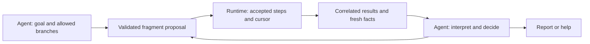
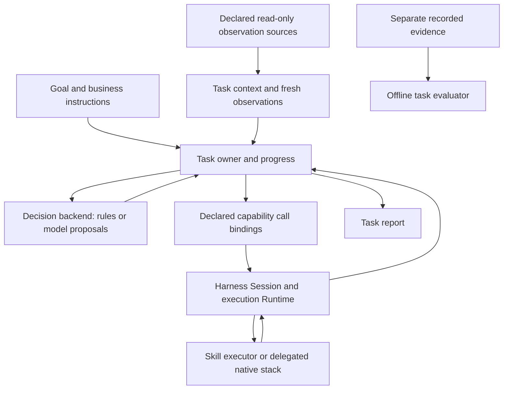

# Robot Agent architecture

Status: **private navigation, ALOHA, inspection policy and Session binding software implemented, 2026-10-12**. This document separates the implemented
architecture from the proposed next increment. It does not add an API, qualify a
new robot task, or change existing application or Harness contracts.

Comparative embodied-system research now informs this responsibility design.
The design baseline has passed independent review; inspection implementation
and repository extraction are not delivered by that review. The selected next task is station-status
inspection with capability-specific failure handling, described below. Its camera
path and private event coordination now have scoped software/stationary ROS
checks below; full task implementation and qualification remain pending.
The selected deployment keeps execution in the existing Linux
simulation container and model access on the host. Fragment delegation is deferred.
No fragment interface or new robot capability is delivered by this proposal.

Robot Agent turns a goal and fresh observations into a bounded sequence of
skills, incorporates results and business instructions, and reports what remains
unresolved. Robot Harness owns execution authority, native work and settlement.
Native robot stacks retain control and device protection. Core belongs to Harness.
A model proposes decisions; it is not the task owner or the execution authority.

## Place in the embodied system

Agent includes a **cognitive harness**: task context, model/tool proposals,
business policy, feedback and reporting. The Robot Harness product provides an
**execution Runtime**: admitted operations, correlation, authority, cancellation
and settlement within its declared profiles. These uses of “harness” describe
different responsibilities; neither product must absorb the other.

The system target combines Agent, execution Runtime, skill executors, observations,
a final motion gateway and platform management. Logical modules do not prescribe
repository or process counts. Keep the two existing product repositories;
an integration repository is a candidate for combined design, pinned combinations,
launchers, CI and demos. Skills, motion and platform components should be extracted
when concrete independent use or deployment needs justify them. No new repository,
gateway, persistent ledger or platform supervisor is implemented by this proposal.

Today the application loop advances task steps. Runtime governs the operations
it receives. If a future accepted plan delegates step progression to Runtime,
define that delegation, plan revision and reconciliation before moving ownership.
Agent retains business decisions; it must not independently drive the same steps
alongside a Runtime mission engine.

An Agent **skill binding** calls a capability and interprets its correlated outcome.
A **skill executor** prepares and runs that capability, handles bounded native
recovery and supplies actual closure observations. Executors may be hosted by
Harness integrations or delegated to existing robot stacks. A learned skill's
policy worker is distinct from the business Agent and its LLM/VLM proposal backend.
Current ACT packaging is a pinned integration, not a general Skill SDK.

Platform health can constrain execution; it is not another business planner.
Final device output and manual takeover belong to the declared motion gateway and
native controller, not to model proposals. Existing scoped simulation protection
does not establish a complete device gateway, hard stop bound or restart recovery.

### Selected coordination structure (partially implemented)

Use a shared event coordinator with separate task policies and replaceable
decision and capability adapters. The coordinator alone commits business task
state. Policies interpret facts and return bounded intents without blocking I/O;
the decision owner manages model calls, and one I/O owner creates, uses and closes
the public Harness Session. Model waits must not prevent consuming stop requests,
relevant fact invalidations or correlated feedback from previously submitted work.

The first inspection task advances one capability at a time: Agent requests
navigation to A, consumes inspection facts after arrival, and chooses completion,
help or the single permitted B visit. Harness owns admitted execution and native
resource obligations; it does not infer inspection branches. Invalidating a model
proposal does not discard an already submitted operation or prove it has stopped.

The first private software increment reuses the exchange/owners and adds
nonblocking `Coordinator.begin/poll`, a one-source metadata inbox with independent
stop/fault latches, and an optional waiting adapter for fixed navigation. Its
source represents navigation context; a fault invalidates proposals and the
original task cancels the original navigation request. It is not an inspection
camera dependency or a general task state machine. Policy callbacks run on the
caller outside locks and must remain nonblocking. Returned asynchronous calls
still require policy interpretation of withdrawal, errors and unknown effects.

Actual event-driven inspection assembly remains implementation work. Private
source time/association, historical-record/current-health separation and camera
data lifetimes now have limited software and stationary ROS checks below. The inbox keeps only bounded
immutable references, not frame bytes or historical inspection records. Preserve
existing entry points and qualified behavior during migration;
validate the new mechanism with inspection and one existing consumer before
widening adoption. This choice creates no new service, public task language or
repository. The deployment/lifetime design below has passed independent review;
inspection/runtime qualification remains pending. The software scope and
verification are recorded in [Testing](TESTING.md#private-event-consumption).

### Explicit execution fragments (deferred alternative)

Retain direct per-capability Session calls for existing applications and the
selected inspection task. Reconsider a separate mode only when a concrete need
requires Agent to explicitly delegate a bounded execution fragment
and receives control at a declared return point. A fragment is a finite accepted
sequence such as `Navigate(A) -> Observe(A) -> return facts to Agent`, not a new
business goal or arbitrary model-generated program. The first target is sequential
and allows at most one active effectful invocation; no generic DAG, concurrent
fleet scheduler or persistent task engine is proposed for that increment.

Agent owns the user goal, permitted business branches, task budget and goal
revision. Runtime owns an accepted fragment's version, execution cursor and
correlated invocation results. It can advance the fragment without waiting for
another model call. Agent must not submit the same fragment's next step itself.
Existing direct-call tasks retain their current step owner and qualification.

At a return point Agent interprets the supplied facts and decides whether to
finish, ask for help or submit another allowed fragment. For example, Runtime
obtains the image at A; Agent decides whether its interpretation warrants B.
Fragment completion does not establish business success, device stopping or full
resource cleanup. Unknown submission/native outcome or profile-specific pending
settlement cannot be converted into readiness for another effectful invocation.

An accepted fragment can be revised only against its current version and active
invocation. The first design uses closure of the old fragment and explicit
readiness before a new fragment, rather than general hot replacement. A late
proposal cannot alter the new goal, and an old cancellation cannot target a new
invocation. Existing navigation revision behavior keeps its separate contract.
No fragment API, serialized plan format or durable recovery protocol exists today.




## Implemented foundation and gaps

| Responsibility | Current implementation | Remaining gap |
|---|---|---|
| Goal, phase, bounded progress and task report | [HandoffTask](../src/robot_agent/handoff.py), [NavigationTask](../src/robot_agent/navigation.py) and concrete navigation variants | Application-specific loops; no shared Agent task engine or general task specification |
| Observation filtering and proposal grounding | Application `measurements`, identity checks and post-proposal revalidation | No common task-context/fact representation; camera/joints and map observations remain distinct |
| Model proposals | [CodexDecision](../src/robot_agent/codex_decision.py), [NavigationCodexDecision](../src/robot_agent/navigation_decision.py), controlled proposals and host relay | Shared bounded subprocess transport, but task-specific prompts/schemas; no qualified general planner or interchangeable multi-model service |
| Execution consumption | Public Harness Session; private navigation execution helper reused by checkpoint/revision/recovery | No shared cross-application skill contract; Nav2 and ALOHA close/reuse semantics differ |
| Outcome assessment | Installed ALOHA and fixed-normal-navigation offline evaluators | Task-specific qualification only; no general verifier or broad reliability evidence |

This is our own business Agent code using Codex as one proposal backend. It is
more than calling a model, but it is not yet a complete reusable Agent architecture.
Adding prompts or another navigation subclass alone will not close that gap.
Existing runnable contracts remain in [Applications](README.md); measured scope
remains in [Testing](TESTING.md). There is no supported shared task engine today.

## Proposed responsibility boundaries

These are responsibilities within the Agent product, not five services or a
requirement to create a class for every box. Initially keep one serial task owner.



| Responsibility | Owns | Does not own |
|---|---|---|
| Task definition and policy | Accepted goal, permitted skills/sites, completion conditions, bounded branches and budgets | Native safety profile, raw control commands or arbitrary model-authored executable plans |
| Task owner | Current phase, outstanding request identity, remaining budget, proposal validation, instruction priority and permitted next step | Core authority or an independent copy of native settlement state |
| Task context | Current task facts, their sensor/receipt provenance, completed work and unresolved outcomes | Hidden simulator truth, persistent recovery authority or a general world model |
| Decision backend | A bounded proposal from declared context and measurements; deterministic baseline or explicit model adapter | Session handles, reset, direct tools, robot access or authoritative success claims |
| Skill bindings | Explicit allowed arguments, observation/action distinction, preconditions, request/feedback association and backend-specific outcome handling | A second executor, ROS control loop, automatic replay or universal close/stop guarantee |

Task policy belongs to the application. Shared mechanisms should capture
proven repetition in task-local budget, proposal binding and reporting; they
should not erase domain-specific observation or closure semantics. A small
explicit skill set is sufficient. No dynamic plugin loader is needed now.

### Cognitive loop and model adapters

Separate task policy from shared cognitive mechanics. A task definition grounds
supported goals, allowed skills and completion conditions. A task owner manages
business intent and the remaining original budget. Task context retains observed
facts, model interpretations, completed work and unresolved execution references.
A decision adapter supplies a proposal; validation and skill bindings mediate its
use. Reporting describes both business progress and unresolved execution facts.
These are module responsibilities, not a required service for every box.

The cognitive loop is: obtain relevant facts, construct bounded context, propose,
validate against the current goal/input and budget, submit through the execution
boundary, incorporate the correlated result, then interpret or replan. In fragment
mode it waits for the declared return point instead of driving each accepted step.
A task-local memory can retain prior facts, but an old memory entry is not a fresh
sensor sample. No persistent memory store, learning loop or autonomous code change
is introduced by this design.

Codex, an API model, a local model and a deterministic decision baseline are
adapter options. The model does not own task state, execution resources or a
Session handle. The adapter must declare the concrete task's input/output,
timeout and cleanup behavior; model quality is qualified separately. Current
Codex transports and task-specific schemas are starting points, not a supported
universal planner interface.

The implemented private proposal subprocess now bounds prompt input to 1 MiB
of UTF-8 before launch and writes the pipe without blocking its owner. Input
backpressure uses the same cancellation signal and original deadline; completed
JSON decoding is followed by another cancellation/expiry check. The existing
owner still terminates, kills when necessary and reaps the child. This transport
repair does not implement the proposed shared task owner, decision thread or
serialized Session I/O owner. See [input and exit checks](TESTING.md#proposal-input-and-exit-checks)
for qualification limits.

Business reasoning, observation interpretation and action inference may use
different models. A detector/ASR can provide labelled estimates or inputs; a VLA
runs inside a skill backend with its action queue and lifecycle; native navigation
and protection keep their own control loop. They need not all share the business
Agent's provider or process.


### Data and decision path

1. The application grounds a user request into its supported goal and bounded
   choices. Unsupported sites/skills require clarification, not fabricated capabilities.
2. Obtain declared measurements and retain their actual source, identity and time.
   A task-local fact includes what was observed, where and when; an inference
   remains labelled as an inference. Do not put evaluator truth into this context.
3. Build the bounded proposal input from that context, allowed actions and the
   remaining original budget. Preserve each application's observation schema.
4. Validate the returned task/phase/observation identity and permitted action;
   revalidate relevant fresh measurements and capability before submission.
5. Submit through Harness with the existing request identity rules. Retain an
   ambiguous outstanding request rather than replaying it. Consume correlated
   progress/native outcomes/Owner receipts without manufacturing release.
6. Update task facts and select a permitted branch, finish, or ask for help.
   Business instructions and cancellation can withdraw a proposal. A model reply
   cannot revive the cancelled task or refresh its original budget.
7. Produce the task report. Offline evaluation consumes separately recorded
   evidence and does not feed the ongoing decision loop or confer authority.

### Ownership and lifecycle

The launcher/caller owns Session startup or connection, decision-backend resources,
sensor-source resources and close. The task owner borrows them for one bounded
run. Harness/native owners own action execution and its actual closure. A sensor
binding may acquire an image but cannot use that access to submit movement.

Keep one outstanding actuating request in the first new task. Read-only operations
have explicit deadlines and provenance but do not allocate Core movement authority.
A read-only skill may fail independently; it cannot imply that a previous action
has stopped. Domain-specific public capabilities determine whether a subsequent
actuating skill is available. `pending`, timeout, lost connection and unknown
submission are not permission to proceed with another action.

Task status, perception assessment, native outcome, Owner-reported settlement and
process cleanup remain separate. An Agent reporting a completed sequence is not
an independent physical-success verdict. Preserve the current qualified result
limits, including final navigation B pending and unknown complete native cleanup.

### Models and deployment

Keep the existing injected `decide(context, observation, deadline, stop_requested)`
shape as a starting point; it is not a new common public schema. Codex is an
initial adapter, not an Agent architecture dependency. A later local model or API
adapter must implement the concrete task's input/output contract and have its own
quality, timeout, cost and lifecycle qualification. Merely implementing the method
is not evidence of comparable decision quality or bounded remote cleanup.

Business LLM/VLM proposals, sensor interpretation, learned VLA skills and native
navigation/control models have different owners. Do not force them through one
business planner. Task-local context can later support memory or RSI experiments;
this proposal does not introduce cross-restart memory, autonomous code changes,
training, vector storage, model serving or a Robot OS deployment supervisor.

<a id="candidate-integration-task-mobile-visual-inspection-paused"></a>
## Selected next design task: mobile visual inspection

Selected bounded goal: **visit registered A, inspect a visible status marker;
finish with a report if normal, or visit registered B once for a second inspection
if abnormal. Ask for help if the observation or execution state is uncertain.**

This task and the dependency-based failure policy are selected design requirements.
The bounded architecture baseline is accepted and first-batch prerequisites are
under development. The private metadata/navigation slice above is implemented;
camera feasibility, temporal contracts and the full inspection strategy remain
pending. The inspection task is not an installed or qualified application.

This tests navigation plus sensor interpretation and a result-driven business
branch. The marker is an explicit simulation test asset, not a production fault
detector. Navigation, normal/abnormal/uncertain interpretation and reporting are
three concrete responsibilities; no new manipulation or third motion goal is needed.

- At A: require the existing correlated arrival/release and fresh map feedback;
  acquire a robot-camera image with station/session/time association.
- A normal observation ends this inspection task at A. An abnormal observation
  permits one B visit only after public execution readiness and fresh revalidation.
  An absent/stale/foreign/uncertain image asks for help; it does not default to B.
- At B: require correlated arrival and fresh feedback, then one read-only inspection
  under its declared sensor contract. This does not turn B's pending settlement
  into release or permit another actuating operation.
- Retain both inspections' observations and interpretation provenance in the
  report. A normal B reading does not erase an earlier abnormal A reading or prove
  that equipment was repaired. At most two navigation submissions and one B branch;
  no automatic action retry, robot reset or unbounded search.
- Use bounded observation windows to handle relevant changes while a proposal is
  pending. This replaces the earlier design candidate's two-image acquisition
  limit; sampling, retention and timeout limits must be declared in the new task's
  deployment profile. Existing navigation and ALOHA contracts are unchanged.
- If the inspection camera fails while navigation does not depend on it and all
  navigation continuation conditions remain valid, let accepted navigation reach
  its current destination, block inspection and subsequent actions, and report the
  need for help. An explicit user stop still requests cancellation of the original
  work. Camera failure is not evidence that navigation itself is safe to continue.

Use actual robot-camera sensor output. A rendered overview, evaluator image,
fixture image or simulator status bit is not a robot observation. RGB plumbing,
viewpoint/marker visibility and timing have not yet been qualified in the current
navigation setup. The public NavigationSession currently declares map pose/time/
health; it has no public navigation camera capability. Do not pretend it already
supports this task or silently add camera data to its existing schema.

After the system boundary and task contract mapping, verify a bounded camera/marker
path in the existing Ubuntu22.04/Humble/Gazebo
Docker environment. If unsupported, report that gap and choose a justified asset
or sensor adaptation; do not claim the task qualified or automatically switch to
Isaac/RTX. Decide the minimal read-only observation binding and its owning project
from that evidence before implementing it. ALOHA camera support does not establish
navigation-camera support.

Start with controlled proposals and deterministic interpretation of the explicit
marker, then let the existing host model path consume the sourced structured facts.
Direct visual-model interpretation is a deferred alternative, requiring a selected
model and separate qualification on actual images. The existing visual proposal
adapter does not establish a navigation inspection backend; a new image schema,
host-image transport and its resource/budget behavior would need separate design
and validation. They are not prerequisites for this first inspection task.

The installed fixed A→B evaluator cannot evaluate this new goal or its A-only
branch. Design a task-specific extension with one evaluator per run, separating
registered-site arrival from marker-interpretation correctness and complete/unknown
execution. Ground-truth marker state is retained only for offline evaluation.
Each new visible feature should have a same-run video and accurate version/scope;
existing navigation recordings cannot qualify or demonstrate inspection.

## Current shared-mechanism candidate

A focused independent design review found the limited first slice ready for
implementation. This is design readiness, not qualification of a new coordinator
or approval to switch the public default.

The current first architecture slice uses the existing fixed navigation A-to-B
task and ALOHA transfer400-to-hold50 task. Inspection, camera acquisition and
fragment delegation remain paused candidates. The first slice preserves direct
per-capability Session calls; Agent continues to advance business steps, while
Harness retains operation authority and settlement. No new mission engine,
public Session protocol or repository is selected for this slice.

Proposed assembly is one application with a business coordinator, a decision
worker and a sole Session I/O owner. The coordinator alone applies task-policy
updates; workers return associated results. A task-local condition/short lock
protects bounded command/completion slots and control intentions. Long calls,
strategy evaluation and joins run outside that lock. Task stop stays latched;
revision withdrawal targets its original decision or execution request. A command
withdrawn before claim makes no Session call; after claim its possible effects
remain associated with the original request, without replay. Completed execution
facts and owner-close outcomes are retained separately. Business deadlines do not
refresh; required cleanup retains its own declared software waits.

Migration starts with the proposal-helper repair and platform CI, then a private
coordinator consumed through an experimental fixed-navigation entry, followed by
actual ALOHA reuse. Existing public task entries remain on their original paths
until separate installation, behavior, applicable CI and implementation review
justify a default change. Checkpoint, revision and recovery applications are not
implicitly migrated. Select one implementation before each task starts; never
fall back to another implementation after an ambiguous submission.

The private handoff/coordinator is implemented for experimental fixed navigation
and ALOHA consumption. Public-default migration remains unimplemented.
Its deterministic handoff races, original budgets/reports,
domain-specific readiness/close, installed combination and selected actual
execution evidence are implementation requirements. Preliminary experiments and
older application tests do not qualify new coordinator behavior.
Design review assesses readiness to implement this limited slice; it does not
establish hardware protection, restart recovery or a general Robot OS.

### Experimental fixed-navigation implementation

[Private task runtime](../src/robot_agent/_task_runtime.py) provides a single
Condition, one unconsumed call per decision/I/O owner, exact-call withdrawal,
latched task stop and independently retained close outcomes. The calling thread
consumes results and advances business state. Resource factories, calls and close
run in their owners; normal completion need not be consumed before owner close.
Long calls and joins stay outside the condition lock. Workers are not daemons.

[Fixed navigation assembly](../src/robot_agent/_navigation_runtime.py) reuses the
existing NavigationTask as the domain policy through private decision and Session
bindings. It preserves observation whitelisting/revalidation, original request
identity, A release before B, final B pending/current and unassessed task verdicts.
Submission deducts queue time from the original operation budget and checks the
original proposal deadline again before the actual call. Failed or withdrawn
in-flight calls retain facts; closing calls refer to the original request.
An unfinished submit report retains the original request ID, site and observation
reference even if closing wait expires before its response returns.

The original business report remains separate from the additional `coordination`
resource outcomes. A completed business report cannot conceal an owner that is
still draining or a close error. A twelve-second overall software closing wait
does not renew the task budget or prove native termination; unfinished owners
remain non-daemon and explicitly unconfirmed. Navigation connection disposal
continues to leave native cleanup unknown. A successful Session close reports
`connection_close=local_closed` within that binding's declared scope. A close
exception reports `connection_close=unknown`: the factory may fail before or
after local disposal. The original error is retained and `resources_closed`
remains false. Neither value confirms remote shutdown, Owner reaping or physical
stop. The adapter does not inspect private transport state or retry close.

The opt-in module entry below is experimental, supports only the fixed task and
does not replace any installed public command. The operator provides a prepared
Owner and a proposal executable/model; controlled CI proposals are not models.

```sh
python -m robot_agent._navigation_runtime \
  --endpoint /path/to/prepared-owner.sock --output /path/to/new-private-run \
  --model YOUR_MODEL --executable /path/to/proposal-cli
```

Local software/installation results and remaining qualification are recorded in
[Testing](TESTING.md#private-fixed-navigation-coordinator).

The [explicit coordination tutorial](../examples/navigation/README.md#experimental-coordination)
now assembles this same private runtime through Harness's public launcher and
the pinned default scoped Owner. Its controlled `normal` and
`final-decision-stop` choices do not replace public CLI defaults. In the latter,
the decision owner requests withdrawal and holds its answer until the I/O close
attempt ends, without an extra timer/worker. The original request remains the
cancel/query target; the late answer cannot restore authority or submit a step.
The deployment selects the Owner's explicit terminal query window. Tutorial
trace/reporting and software completion do not establish physical stopping,
native cleanup, remote acknowledgement or a stable coordinator API.

The same explicit tutorial now accepts `host-codex` for `normal` only, with an
explicit model, separate private host output and terminal query window. The
container's decision owner constructs the existing NavigationCodexDecision around
the installed relay. The existing host worker owns its CLI processes and private
logs; it reconstructs declared task/measurement context and never receives a
Session. The coordinator owns task state, and the I/O owner keeps the public
NavigationSession and its original cancellation/close obligations.

External interruption latches task stop and withdraws the original decision
call. Relay cancellation notifies the host helper while the independent I/O
owner cancels/queries original B and closes. Completion cannot reopen authority
or replay a request. The original task/proposal budgets and unknown native/remote
cleanup remain. Host proposals cannot use the controlled final-decision-stop
scenario. Software coverage of this assembly does not transfer the legacy host
path's real-model or simulation qualification; no public default is migrated.

### Experimental ALOHA reuse

[ALOHA assembly](../src/robot_agent/_handoff_runtime.py) consumes the same
TaskCalls, SessionBinding and `run_owned_task` as fixed navigation, in addition
to the same Coordinator/Owner/exchange. The common module contains no site,
skill-name or business-stage branches. Existing HandoffTask still owns policy:
current camera/joints → transfer400 → settled/released → fresh observation →
hold50 → settled/released → final visual assessment. Old observation or
unconfirmed transfer release cannot start hold. Visual assessment remains
separate from an independent task verdict.

Domain bindings retain request/site or request/skill/steps/observation association
and interpret close separately. Navigation connection disposal leaves native
cleanup unknown; ALOHA's public Session close confirms worker cleanup and Host
reap only when it returns successfully. A close error leaves cleanup unconfirmed.
Business completion cannot hide missing owner termination. The selected ALOHA
software closing wait is at most30 seconds for remaining RPC, cancel/status and
close; startup/arbitrary plugins and robot stopping have no hard bound here.

Stopping while the after-transfer decision waits blocks hold. A released transfer
has no active cancellation obligation; a claimed unfinished submission retains
its original request and outcome uncertainty, without replay. Both owners close
independently of ordinary completion consumption. Public handoff/navigation
commands and checkpoint/revision/recovery continue their original paths.

A late observation retained in the task report omits binary RGB and labels the
omission explicitly. Its measurement metadata and original call identity remain
available for reconciliation; this record is not a complete model observation.
Normal observation consumption and model input keep their original image data.

```sh
python -m robot_agent._handoff_runtime \
  --output /path/to/new-private-run --checkpoint /path/to/prepared-policy \
  --device cpu --model YOUR_MODEL --executable /path/to/proposal-cli
```

Use the original [ALOHA setup](../skills/aloha/README.md) for the actual skill
environment. Software fixtures do not qualify ACT/physics or a visual model;
selected actual execution/video and public-default migration remain separate.
See [ALOHA reuse checks](TESTING.md#private-aloha-reuse).

<a id="incremental-implementation-and-acceptance"></a>
## Selected inspection deployment and fact lifetime (design)

Keep Agent, Harness and the navigation/camera simulation in the existing Linux
container. Reuse the host model bridge, with credentials and raw model logs on
the host. This is a selected design, not qualification of a new camera pipeline.
The first interpreter uses only real camera pixels and declared station/pose/time
association; simulator truth is reserved for independent evaluation.

Check freshness when accepting a sample into a bounded inspection window. Closing
that window produces a time-scoped inspection record; it does not require the
original frame to remain a current frame when a slow model returns. A window that
ends normally is not a camera failure. Missing or conflicting unsupported readings
produce unknown. Retain both A and B records without rewriting an earlier anomaly.

Continue bounded source-health, generation and clock-continuity monitoring while
a decision is pending. Missing fresh health evidence is unknown. A source failure,
changed generation, corrected station/quality association, changed goal or revoked
permission invalidates affected proposals. The first task latches camera failure
as help rather than automatically retrying after recovery. A later frame describing
a different observation time does not erase a historical record or trigger an
unbounded redecision loop.

Before B submission require the valid A-anomaly record, unchanged permitted task,
remaining budget, current camera health, and actual native navigation readiness
and reuse conditions. After acceptance, navigation follows its own dependencies;
camera failure blocks inspection and further actions while independent navigation
may finish. Stop requests always request cancellation of the original operation.
Keep bounded observation storage separate from latched control/invalidation and
correlated completion slots. Sample references remain valid until their borrower
finishes or explicitly releases them; replacing a latest slot cannot overwrite
borrowed bytes. Source and resource shutdown remain distinct from task reporting.

## Private inspection source contract

The private `_inspection_source` software implements the historical/current
separation above. It owns one latest immutable RGB frame, one bounded read and
at most two pixel-free closed-window records. Default SourceProfile is5 seconds,
5Hz acquisition admission,640×480 RGB,1-second health/frame ages and3–25 results.
Pose is snapshotted before validation; mutable pixels are copied. The adapter
supplies actual image-time pose, registered target and same-clock acquisition
plus local receive time. It owns startup/readiness and producer shutdown.

A closed record is not expired just because its window ended. Source health
must continue; silence, paused/backward clock, generation or required-input
failure latches unavailability while preserving history. Inbox turns refresh
health even with a blocked decision owner. Source failure withdraws decisions
without automatically cancelling independent I/O. `applicable` covers only
source/record validity; policy still checks goal, permission, budget and native
readiness/reuse before any action. No new worker or authority owner is introduced.

Consumers explicitly release their frame read. Deadline/release/close checks
prevent new reads or recording stale results; returned immutable bytes cannot be
revoked and must not be called current later. Latest replacement cannot overwrite
borrowed data. Classification belongs to the image interpreter; missing/unknown
or contradictory results produce unknown rather than favorable frame selection.
The current private A/B source has software checks and a bounded live ROS binding,
but no complete inspection-policy qualification. Heartbeats must come from actual source health,
not a local timer, process-alive flag or advancing /clock alone.

## Inspection implementation handoff

Implementation follows the reviewed design baseline. The selected path uses
per-capability progression, not execution fragments. Keep three bounded increments:

1. **Prerequisites and event coordination:** investigate native shutdown ordering
   in the Harness combination; extend the private mechanism with nonblocking
   policy progression and bounded fact/control/completion handling. Validate with
   an existing consumer and confirm actual camera acquisition, station/time
   association and marker visibility before building the inspection workflow.
2. **Inspection loop:** implement A observation, normal completion, one permitted
   B recheck and uncertainty/help. Begin with deterministic image interpretation
   and controlled decisions; bind model proposals to the same sourced facts and
   permission checks. Test source invalidation during model waits, dependency-aware
   continuation and explicit stop. Include a model response after the observation
   window closes: valid historical evidence may still be consumed, but a real source
   failure during the wait must block the next action. Preserve prior entry points
   and task contracts.
3. **Fixed installed delivery:** normal A-only, abnormal A→B, uncertain/stale/foreign
   sensor zero-B, rejected/unknown execution zero-next-action and cancellation or
   late proposal checks. Preserve old navigation/ALOHA regressions. Use fresh
   installations, one offline evaluation per physical run, focused independent
   safety checking, applicable exact CI and a same-run public video/tutorial.

A bounded stationary Humble/Gazebo source probe has established actual camera
pixels, clock/CameraInfo and image-time TF association at two registered stations.
This supports retaining the selected source path. A subsequent private binding
qualifies post-window image-derived health and local observation-path loss with
a controlled waiting owner. Neither probe qualifies arrival, orientation/target
registration, full inspection, a real model or a hard stop bound.
The first increment now has the private history/health/read software above;
actual ROS binding and source lifecycle must precede the second increment's
task consumption. No public camera Session API is implied.

The new event-driven extension is accepted only if both the inspection task and
an existing application actually consume it, and domain-specific receipt/close
handling remains intact. Tests of an unused abstraction do not establish reuse.
Independent implementation review is required for affected ownership, cancellation,
authority or public protocol changes. Design review is not implementation approval.

Alternatives: another navigation-only branch would extend behavior but would not
exercise cross-skill context; navigation-plus-grasping would require a new combined
robot and native resource contract before providing this first architecture test.
A full generic planning framework would freeze untested abstractions. This bounded
inspection task is the selected next design task. Revisit the choice if real camera
feasibility, a concrete consumer or a deployment requirement changes those premises.

## Private ROS inspection binding

The lazy-import `_inspection_camera` owner uses a separate ROS Context and an
executor attached to that Context. The caller pumps callbacks and owns source,
executor, node and Context shutdown; no background spin thread is introduced.
The pure binding owns one pending immutable image alongside the source's latest
frame/read. Matching clock, CameraInfo and TF may arrive later, within the original
receive-age limit. One image acquisition stamp renews health at most once.
Missing map TF/AMCL prevents inspection but does not suppress camera health when
new images and optical association remain valid. The closed window continues
health observation without accumulating pixels or requiring the old station pose.

Actual new images, advancing clock, finite intrinsics, optical association and
one stable publisher are required. Clock callbacks or a live process alone cannot
renew health. Humble fixed-double CameraInfo values normalize once at the typed
boundary, then retain finite/positive checks. Final admitted association metadata
is separate from the earlier health snapshot. Publisher GID is graph identity in
the isolated single-publisher profile, not authenticated per-message provenance.
AMCL is a timestamp/frame readiness gate; image-time TF supplies station position.

The private `_inspection_marker` interpreter reads only pixels of the controlled
colored panel and white border; it is not a general visual model. Gazebo truth
is absent from the online adapter. A stationary offline qualification covered
normal post-window ten-second waiting and local image-subscription loss while
clock continued, with historical classification retained and current applicability
revoked. This does not qualify a moving inspection task, device failure, model,
throughput, physical stopping or restart recovery. See [Testing](TESTING.md#private-ros-camera-binding).

### Opt-in localized panel reader

The private `read_marker` interpreter locates a controlled white-bordered red/green
panel from immutable 640x480 RGB pixels. The existing `classify` interpreter and
caller default keep their fixed-center behavior. The private caller can select
`--marker-reader located-white-panel`; there is no automatic fallback or motion.

The `located-white-panel-v1` profile supports a separated, near-frontal frame,
80x60 to 560x400 pixels, with aspect ratio 0.9 to 3.0. Each of four proportional
border bands must have at least 0.6 white coverage. A single enclosed non-white
interior is required; multiple interiors, an open interior reaching the declared
reading region, or a substantial white fragment at the image edge yield unknown.
The latter conservatively rejects some background structures as view ambiguity.
Connected white pixels alone do not establish one target. Target identity is
still a declared station/profile assumption, not visually authenticated.

The reading region is inset by fixed proportions of the white-frame bounds
(12% horizontally, 20% vertically), before inspecting state color. Dominant color
coverage must reach 0.7; opposite color coverage above 0.05 is conflicting evidence.
These ratios describe the new region, not equivalence with the legacy fixed ROI.
The profile rejects unsupported scale, missing/ambiguous/incomplete frames and
insufficient color; it is not general object detection or perspective correction.

One immutable `MarkerReading` carries classification and pixel-free diagnostic
region, ratios, reason and profile. The existing caller records diagnostics only
after the original Source accepts the sample. CheckRecord remains the single
history/applicability authority; diagnostics cannot revive a record or grant B.
The original window, sample limits, current source supervision, request identity,
budgets and unknown-help policy remain unchanged. Work stays synchronous on the
caller with bounded image/component traversal; measured cost is not a hard stop
bound. Late reads are discarded under the original source/window deadlines.

### Opt-in bright-white panel profile

`read_bright_marker` uses the same locator and quality rules with a strictly
brighter white-frame predicate: every RGB channel must exceed 220. Its
`located-bright-panel-v2` profile targets the controlled emissive panel against
neutral gray backgrounds. Select `--marker-reader located-bright-panel`
explicitly; v1 retains its threshold of 150 and the default remains fixed-center.
Both localized profiles retain the same scale, completeness, uniqueness, border
and state-color checks. Bright backgrounds, clipping and uncertain observations
remain unknown. This profile does not identify a physical target or qualify a
moving task, camera view or stopping behavior.

## Private station inspection policy

`_inspection_policy` implements a pure, bounded state transition at the Agent
task-strategy boundary. The caller commits each returned immutable state before
executing its intents through the existing Coordinator and owners. The policy
owns no Session, model, camera, thread or execution authority. A capability
adapter must establish navigation association, arrival pose and reuse; the source
adapter must establish record applicability and current health. Ordinary Python
condition objects do not establish these facts for an actual robot.

The flow is A navigation/check/decision, then completion, help or one B visit and
check/decision. At most two navigation requests and two checks are retained.
Decisions bind task/revision/site/window/source generation and original budgets.
A must be reusable before observation or B admission. Unknown, foreign or stale
bases produce help without a new action. B's result retains A's anomaly; it does
not declare repair. A completed business report can retain B pending and always
leaves independent task verdict and native cleanup unassessed/unknown.

A reserved request is not an accepted operation. Loss of the inspection source
withdraws an unconfirmed submission and requests cancellation/query of the
original possible effect. Known accepted navigation can continue to its original
destination while its own conditions and budget remain valid; no inspection or
successor is admitted. Explicit stop, goal change, navigation failure and expiry
request cancellation of the original unresolved operation. Terminal policy state
still records late correlated execution facts, without restarting the task.
Queued exchange work can be withdrawn; claimed work may already have effects.
The actual binding must revalidate admission immediately before submitting and
retain its late result. This is not a global atomic cancellation cutoff.

[Software verification](TESTING.md#private-station-inspection-policy) covers the
reducer and controlled owner interleavings. Actual public-Session/camera assembly,
moving inspection, real model, physical stop and final paired installation remain
separate work. No public command, dependency or Harness pin changes here.

## Private inspection navigation binding

`_inspection_navigation` adapts only the public Navigation Session in the
existing I/O owner. A private `NavigationContract` holds the established
capability, map measurement, original request/native receipt and result checks
shared with fixed navigation; the original imports and task behavior remain.
The adapter produces policy facts only after matching request/site/operation,
observation reference and authority binding. Arrival additionally requires the
domain result/native identity and fresh map pose. A must arrive and release;
B's arrival retains its current/pending native context.

The caller authorizes an immutable original Admission. Short locked grant and
revocation state crosses the caller/owner boundary; RPCs and Source calls never
run under that lock. After claim, the owner obtains actual current capability
and fresh observation. Source health/generation, original deadlines, stop and
revocation are rechecked after preparation and source checks, and again just
before Session submission. B requires actual reusable A and the original
applicable A anomaly record. Revocation retains the original site reservation;
the task cannot replace its admission, extend its budget or repeat a site.

An attempt's original observation reference is retained before the RPC. An
ambiguous reply cannot cause resubmission; status/cancel use the original request.
Source loss blocks new submission but does not suppress original status/cancel.
Cancel and connection-close responses remain distinct from native stop/release.
The final local check is not a global atomic cancellation cutoff.

[Binding verification](TESTING.md#private-inspection-navigation-binding) includes
installed public Session/socket/Core with synthetic native/source facts. The
follow-on caller loop is described below. Moving inspection, actual camera
navigation, real models and physical stopping remain unqualified. This private
binding adds no public CLI/API or Harness dependency change.

## Private inspection caller loop

The opt-in `python -m robot_agent._inspection_runtime` assembly connects the
station policy, Camera/Source and public Session binding through the existing
Coordinator. The caller commits immutable policy state before finite intents,
pumps camera callbacks and borrows/releases each frame locally. Separate decision
and I/O owners retain their original resources; no new execution authority or
system scheduler is introduced. The first provider is a finite rule, not a model.

Controls/source faults precede original I/O facts, which precede proposal
admission. Original navigation progress and current conditions are read during
inspection and decision waits. A preparation failure cannot erase a previously
obtained execution fact. Feedback uses its original receive-time anchor; it
cannot be renewed just by consumption. Confirmed independent navigation may
continue through camera loss while its own conditions remain valid. Explicit
stop withdraws proposals/submissions and cancels the original possible effect.

The Source owns the one window deadline. A late interpretation is dropped while
normal closure retains earlier history; interpreter/read faults still invalidate
the source. Readers release in `finally`. Reserved and authorized requests remain
distinct, including initialization/admission failure before any submission.
Reports normalize retained original facts at one JSON boundary, including
Coordinator callback-failure retention. An actual runtime failure is reported as
failure, not a fabricated user goal change.

Startup consumes the original task budget. Cleanup consumes late original I/O,
requests only original cancellations, stops both owners and waits within its
original cleanup budget before closing camera/source. An unfinished owner remains
draining; a close error preserves attempt identity and keeps resources_closed
false. Local resource closure does not prove native stop or physical success.
Public commands/defaults and the Harness dependency pin remain unchanged.
[Software checks](TESTING.md#private-inspection-caller-loop) qualify controlled
sources and native facts. Selected moving and source-loss checks are qualified
below; full explicit-stop qualification and final paired migration remain open.

## Selected moving inspection qualification

The private caller has now consumed actual Humble/Nav2/Gazebo navigation and
RGB camera observations in two isolated research scenes: normal A-only and
abnormal A followed by one B recheck. The original map, drive authority and
native contexts remain; visual-only status panels supply a controlled task.
Online input is public Session feedback and associated pixels, never Gazebo truth.
A rule provider routes the observed state. This is not a general visual model.

Native arrival permits observation only after A release/current pose checks.
The report retains A's anomaly when B is normal; B remains pending and cannot
be reused. Cleanup cancels the original B, with retained receipts reporting revoked
authority and pending settlement. Local Owner/connection disposal does not
upgrade native cleanup or independent task verdict. The bounded source record
remains distinct from current health and from independently collected physical pose.

These checks used the current private Agent assembly and retained Harness runtime
with its ROS shutdown repair. The public dependency pin/defaults remain unchanged.
Research scene adaptations are not a supported public inspection launcher.
Further fault coverage, whole-scene explicit-stop qualification, real-model
qualification, final paired installation and reusable tutorials remain gates. [Testing](TESTING.md#selected-moving-inspection-checks)
records measured scope and earlier failures.

The same private loop has also qualified a healthy ten-second decision wait and
actual Image subscription loss during A's decision. New associated image health
keeps a normally closed check usable during waiting. When images cease while
clock messages continue, original Source health expires; the anomaly remains
history, the old visit-B proposal is withdrawn, and no B is admitted. The
controlled provider deliberately returns its original correlated proposal after
withdrawal, so the check covers late-result rejection rather than provider silence.

An explicit stop during B's decision was observed to cancel the original B and
withdraw its late proposal while retaining pending/revoked receipts. That entire
scene remains unqualified: independent A arrival exceeded its fixed physical
threshold. Earlier startup and B-wait navigation freshness failures remain open.
These are limited research observations, with unchanged public APIs, pin and
budgets; they do not establish physical stop deadlines or sustained operation.

A later bounded diagnostic observed both existing TF consumers advancing during
B's ten-second decision wait; the earlier intermittent feedback expiry was not
reproduced and remains unexplained. This does not justify changing freshness
requirements or execution scheduling.

One research arrival-margin trial tightened both controller XY tolerances to
0.15 m and read the actual values from both controllers before public admission.
Physical A arrival was observed closer, but the fixed central image region did
not cover enough of the marker. The check remained unknown, preserving history
and requesting help with no B or decision. That trial did not reach explicit stop
and its whole-scene evaluation failed. It shows that navigation arrival and
inspection viewpoint/reading quality need distinct conditions. The research
configuration has not changed public defaults or qualified a general detector.
